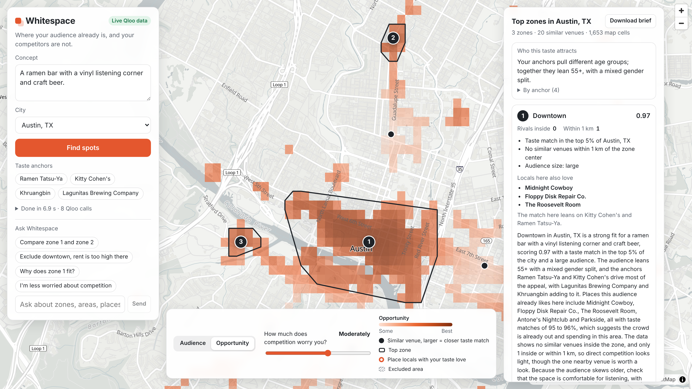

# Whitespace

**Find the neighborhoods where your concept's audience already lives and goes out, but similar venues are still rare.**

Describe a venue concept and pick a city. Whitespace turns the concept into taste anchors from Qloo, maps how strongly every ~150 m cell of the city matches that taste, subtracts competition weighted by how much the same audience likes each rival, and shows the top 3 zones on a map with reasons you can check. Then you keep talking to the agent: exclude an area, care less about competition, compare two zones, ask why a place is on the list.

- **Live demo:** https://d3qszcalamj7w3.cloudfront.net
- **Devpost:** https://devpost.com/software/whitespace-0dvx1n
- **Video (3 min):** https://www.youtube.com/watch?v=VHZgg-X6KXM



Built for the [Qloo Agentic Hackathon](https://qloo.devpost.com) (2026).

## Try it in one minute

1. Open the demo. The example concept is already filled in: _"A ramen bar with a vinyl listening corner and craft beer"_ in Austin, TX. Press **Find spots**.
2. Watch the steps arrive: taste anchors (Ramen Tatsu-Ya, Kitty Cohen's, Khruangbin, Lagunitas), the taste heatmap, ramen competitors, then the top 3 zones with their neighborhood, the places locals with this taste love, and a short brief.
3. Switch the map between **Audience** and **Opportunity**, and drag the competition slider. Zones are recomputed instantly in the browser, with no new API calls.
4. Ask the agent: _"Exclude downtown"_, _"Compare zone 1 and zone 2"_, _"I am less worried about competition"_, _"Why is zone 2 a good fit?"_
5. Open **How Whitespace used Qloo** under the zone cards to see every Qloo call: endpoint, parameters, result count, time and whether it came from cache.
6. Press **Download brief** for a Markdown report with the map, zones, reasons and competitors.

Brooklyn and Chicago work the same way: pick them in the city list.

## The problem

Site selection tools tell you how many people pass by, who lives nearby and what rent costs. They do not tell you whether those people will love _this_ concept. A ramen bar with vinyl and craft beer and a family café can sit on the same foot traffic and have opposite fates.

Whitespace is a first filter for:

- small business owners opening a first or second location;
- franchisees and chain managers choosing a neighborhood;
- commercial real estate brokers who need to justify a location to a client.

## Why it only works with Qloo

Without Qloo this project is a map of competitors, which any mapping service already gives you. Qloo provides the parts no map or census table has:

- **A taste heatmap for this exact concept.** Qloo returns a percentile taste match for every geohash-7 cell of the city (about 1,650 cells in Austin, 2,200 in Brooklyn, 2,600 in Chicago) for the specific venues, artists and brands that describe the concept. It is not population density: in our tests the heatmaps for a ramen bar and a family café in Austin had a Spearman correlation of 0.51, and their top 5% of cells overlapped by only 10%.
- **Cross-domain taste.** A concept is described by a restaurant, a band and a beer brand at once. Qloo links them into one audience.
- **Competition weighted by taste.** For every competitor we ask Qloo how much the same audience likes it. A rival your audience loves pushes a zone down more than a random venue of the same category.
- **Explanations from data.** Qloo explainability tells us which anchors drive each place's match, and the demographics endpoint tells us who the audience is. The agent explains zones with these facts, not with guesses.

## How Whitespace differs from location-analysis agents

The grand prize of Qloo's 2025 hackathon went to [GeoTaste](https://devpost.com/software/geotaste-your-agentic-qloo-taste-business-consultant), a business consultant agent that analyzes the business environment of a location you choose, with charts and a chat. It showed that Qloo is a strong fit for location intelligence. Whitespace answers the inverse question and is built differently:

|                 | Analyzing a chosen location             | Whitespace                                                                                  |
| --------------- | --------------------------------------- | ------------------------------------------------------------------------------------------- |
| Starting point  | A location you already have in mind     | Your concept and a city                                                                     |
| Question        | "What is this place like for business?" | "Where in this city should this concept open?"                                              |
| Taste signal    | Data about that location                | A heatmap of the taste defined by your concept's own anchors                                |
| Competition     | Businesses around that location         | Competitors of your category, each weighted by how much your audience likes them            |
| Result          | Insights and charts about one place     | Ranked, comparable zones across the whole city, with reasons computed by code               |
| Role of the LLM | Writes the analysis and answers in chat | Parses the concept, drives tools and writes briefs; it can only name entities Qloo returned |
| Chat            | Questions about the results             | Changes the analysis: excludes areas, re-weights competition, swaps anchors, compares zones |

## How Qloo is used

Every call goes through one client (`api/src/qloo/client.ts`). Each analysis step appears in the Trace panel.

| Step                   | Endpoint                                      | Key parameters                                                                                          | What we get                                                                      |
| ---------------------- | --------------------------------------------- | ------------------------------------------------------------------------------------------------------- | -------------------------------------------------------------------------------- |
| Taste anchors          | `GET /search`                                 | `query`, `types`; for venues the user named, `filter.location` at the city center and `sort_by=match`   | Venues, artists and brands that describe the concept                             |
| Category tag           | `GET /v2/tags`                                | `filter.query`, `feature.typo_tolerance`, then `feature.semantic_search` as a fallback                  | The competitor genre, e.g. `urn:tag:genre:place:restaurant:ramen`                |
| Audience heatmap       | `GET /v2/insights`, `filter.type=urn:heatmap` | `filter.location=<locality id>`, `signal.interests.entities=<anchors>`                                  | Taste match and popularity for every cell of the city                            |
| Competitors            | `GET /v2/insights`, `urn:entity:place`        | `filter.location`, `filter.tags`, `operator.filter.tags=union`, `take`, `page`                          | Every venue of the category in the city                                          |
| Competitor taste match | `GET /v2/insights`, `urn:entity:place`        | `filter.results.entities=<competitor ids>` in batches of 50, `signal.interests.entities`                | How much the audience likes each competitor                                      |
| Zone profiles          | `GET /v2/insights`, `urn:entity:place`        | `filter.location=<WKT polygon of the zone>`, `signal.interests.entities`, `feature.explainability=true` | Places locals with this taste love, their neighborhood, which anchors drive them |
| Audience portrait      | `GET /v2/insights`, `urn:demographics`        | `signal.interests.entities`                                                                             | Age and gender lean of the audience, overall and per anchor                      |
| Explain a place        | `GET /v2/insights`, `urn:entity:place`        | `filter.results.entities=<place>`, `signal.interests.entities`, `feature.explainability=true`           | Why one place matches, for the agent's `explain_place` tool                      |

The client is built around how the API behaves:

- **Parameter allowlist per `filter.type`.** Qloo silently ignores parameters it does not support and answers 200, so a typo would look like a real but wrong result. The client refuses to send any parameter that is not on the list for that type.
- **Rate limits.** The hackathon key allows 5 requests per second and 10,000 per month. The client keeps to 4 per second, retries `429` and `5xx` with backoff, and caches responses in memory and on disk.
- **Stale beats broken.** If Qloo is unavailable, the server serves the last saved real response and marks it as cached in the Trace panel.
- **Raw responses stay on the server.** They are normalized in `api/src/qloo/types.ts`; the browser only gets what it draws.

## Scoring

The scoring model lives in `shared/src/scoring` as pure functions with tests, so the browser and the server run the same code.

```
pressure(cell)    = Σ over competitors  w · exp(−d² / 2σ²),   w = 0.5 + 0.5 · affinity,   σ = 600 m
                    normalized by max(P95, 1) and capped at 1
opportunity(cell) = affinity · (1 − competitionWeight · pressure)
                    0 below minAffinity (0.7) and inside excluded areas
```

- The heatmap is smoothed with a Gaussian over each cell's 8 neighbors and turned back into a percentile, so single spikes such as the airport do not become zones.
- Zones are DBSCAN clusters of the top 5% cells by opportunity (at least 20 cells), with the radius adapted to the cell size. A zone's score is the mean opportunity of its 10 best cells with a small bonus for size.
- The reasons on each zone card are computed by code: taste match percentile in the city, similar venues within 1 km compared with the typical area that has this audience, audience size, places locals love.

## The agent

The agent runs on an LLM with tool use, through the Anthropic API or Amazon Bedrock. A deterministic pipeline does the first analysis, so the result is reproducible; the agent handles the conversation around it.

| Tool               | What it does                                                         |
| ------------------ | -------------------------------------------------------------------- |
| `run_scout`        | Full analysis for a concept and a city                               |
| `update_anchors`   | Adds or removes taste anchors through Qloo search and reruns         |
| `adjust_scoring`   | Changes how much competition matters or the minimum taste match      |
| `exclude_area`     | Excludes a neighborhood by name or a zone, then recomputes the zones |
| `reset_exclusions` | Brings excluded areas back                                           |
| `profile_zone`     | Detailed profile of a zone                                           |
| `compare_zones`    | Facts about two zones side by side                                   |
| `explain_place`    | Why a place matches the taste, from Qloo explainability              |

**Grounding.** The LLM never writes the name of a place, artist or brand. It refers to entities from the current analysis with `[[id]]` tokens, and code substitutes the names. Every reply and zone brief is checked: unknown tokens or capitalized names that are not in the data fail the check, the model gets one retry, and then a template answer is used. The agent cannot recommend a place Qloo did not return.

**Basic mode.** If the LLM is unavailable, the chat still understands simple commands ("exclude downtown", "compare zone 1 and zone 2", "explain …") and answers from the data, marked as Basic mode in the interface. The concept is then parsed by keywords.

## Architecture

```
┌──────────────────────────────────────────────────────────┐
│ web: React + MapLibre (OpenFreeMap tiles)                │
│  concept · anchors · map layers · zone cards · chat      │
│  Trace panel · slider rescoring with shared/scoring      │
└────────────────────────────┬─────────────────────────────┘
                             │ /api/scout (SSE), /api/profile, /api/chat
┌────────────────────────────▼─────────────────────────────┐
│ api: Node.js + Hono                                      │
│  scout pipeline → scoring (shared) → profiles → briefs   │
│  agent: LLM + tools, grounding check, basic mode         │
│  Qloo client: allowlist · limiter · retries · cache · trace │
└────────────────────────────┬─────────────────────────────┘
                             ▼
                  hackathon.api.qloo.com
```

The demo is one link and the Qloo key never leaves the server. On AWS, CloudFront serves the web app from S3 and sends `/api/*` to the same Hono app on Lambda, streaming the SSE response; elsewhere one container serves both.

```
shared/   types, supported cities, demo scenarios, scoring model
api/      Hono server: Qloo client, scout pipeline, zone profiles, agent, rate limits
web/      React app: map, panels, chat, brief export
infra/    AWS CDK stack: CloudFront, S3, Lambda with response streaming
scripts/  synthetic fixtures, smoke test, cache warm-up
```

## Run locally

Requires Node.js 20 or newer.

```bash
npm install
```

**With a Qloo key.** Copy `.env.example` to `.env`, set `QLOO_API_KEY`, and optionally `ANTHROPIC_API_KEY` for the agent (or AWS credentials for Amazon Bedrock: `AWS_BEARER_TOKEN_BEDROCK` and `AWS_REGION`). Without an LLM key the chat works in Basic mode.

```bash
npm run dev
```

The app opens at http://localhost:5173 and the API runs on :8787.

**Without a key.** Demo mode uses synthetic fixtures, makes no Qloo calls and shows a "Demo data" badge:

```bash
npm run demo
```

`npm run demo` sets the variable POSIX-style; on Windows run it from Git Bash or WSL.

**Production container:**

```bash
npm run docker:build
```

```bash
docker run -p 8090:8080 -e DEMO_MODE=true whitespace
```

For live data pass `-e QLOO_API_KEY=...` instead of `DEMO_MODE`, and mount a volume at `/data/qloo` to keep the response cache between restarts.

**On AWS:** put `QLOO_API_KEY` and `ANTHROPIC_API_KEY` in a Secrets Manager secret, then deploy the CDK stack:

```bash
npm run deploy -- -c keysSecret=whitespace/keys
```

The stack runs the API on Lambda with a streaming function URL behind CloudFront, keeps the Qloo cache in S3 and prints the site URL. Setup, options and limits are in [docs/DEPLOY.md](docs/DEPLOY.md).

| Variable                                      | Default                          | Purpose                                                                                                |
| --------------------------------------------- | -------------------------------- | ------------------------------------------------------------------------------------------------------ |
| `QLOO_API_KEY`                                | none                             | Qloo hackathon key, server side only                                                                   |
| `QLOO_BASE_URL`                               | `https://hackathon.api.qloo.com` | The hackathon key only works here                                                                      |
| `DEMO_MODE`                                   | `false`                          | Synthetic or recorded data, no Qloo calls                                                              |
| `QLOO_CACHE_DIR`                              | `/data/qloo` in the container    | Disk cache of Qloo responses                                                                           |
| `ANTHROPIC_API_KEY`                           | none                             | Anthropic API access for the agent                                                                     |
| `ANTHROPIC_MODEL_ID`                          | `claude-sonnet-5-5`              | Model for the agent, briefs and concept parsing                                                        |
| `AWS_BEARER_TOKEN_BEDROCK`, `AWS_REGION`      | none, `us-east-1`                | Amazon Bedrock access instead of the Anthropic API                                                     |
| `BEDROCK_MODEL_ID`                            | see `.env.example`               | Model on Bedrock                                                                                       |
| `LLM_PROVIDER`                                | auto                             | `anthropic` or `bedrock` picks the provider (auto prefers the Anthropic key), `none` forces Basic mode |
| `SCOUT_LIMIT_BURST`, `SCOUT_LIMIT_PER_MINUTE` | `8`, `3`                         | Per-IP limit on analyses; answers fully served from cache are free                                     |

## Checks

```bash
npm test
```

```bash
npm run lint
```

```bash
npm run typecheck
```

Tests cover response normalization, the parameter allowlist, the scoring model (competition, exclusions, zones on geohash-6 and geohash-7 grids, stable zone ids), grounding, the agent tools and the `/api/scout`, `/api/profile` and `/api/chat` routes. They run on synthetic fixtures only. `npm run smoke -- <url>` checks a deployed server and `npm run warm -- <url>` warms its cache.

## Data and Qloo terms

Qloo's terms do not allow storing API responses in a public repository. Everything in `api/fixtures` is synthetic and generated by `npm run fixtures` (fictional places and ids). Real responses are cached only on the server's private volume; `api/recordings` is gitignored.

## Limitations

- Taste match is a first filter, not a full site analysis. Rent, foot traffic, zoning and a visit in person still decide; every brief says so.
- Three supported cities: Austin, Brooklyn and Chicago. Free-form city input is left out on purpose, since small cities give weak heatmaps.
- Competitors come from one main category per analysis.
- Qloo has no neighborhood boundaries (the locality boundary option returned an error), so neighborhood names come from places and excluding a neighborhood uses the outline of its places.
- Competitor taste matches are narrow (about 0.80 to 0.95 in our tests), so taste weighting separates rivals only moderately.
- After you move the slider, new zones get Qloo profiles but no new LLM brief.

## License

[MIT](LICENSE)
